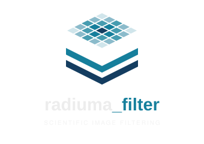

<p align="center">
  
</p>

# radiuma_filter: Python Image Filtering Library

**PyPI:** [Link](https://pypi.org/project/radiuma_filter/)

**GitHub:** [Link](https://github.com/radiuma-com/radiuma_filter)

**Code Overview:** `radiuma_filter` is a Python image-filtering library for
NumPy arrays and supported image files. It provides reusable filter objects,
sequential and independent filter pipelines, and a consistent
`execute(inputs=...)` interface. Filtered results are returned as NumPy arrays.

The two main interfaces are:

- **Individual filters:** Configure a filter such as `GaussianFilter` and run
  it with `.execute(inputs=image)`.
- **`FilterPipeline`:** Combine filters to apply them sequentially or
  independently to the same input.

Execution behavior, including error handling and progress reporting, can be
configured with `ExecutionOptions`.

## 🔍 Table of Contents

- [🎥 YouTube Tutorials](#-youtube-tutorials)
- [🧩 IBSI Compliance](#-ibsi-compliance)
- [✨ Key Features](#-key-features)
- [📥 Installation](#-installation)
- [📚 Library Usage](#-library-usage)
  - [Standalone Script](#standalone-script)
  - [Embedded Library](#embedded-library)
  - [Individual Filters](#individual-filters)
  - [File Inputs](#file-inputs)
  - [Filter Pipelines and Execution Options](#filter-pipelines-and-execution-options)
- [🧩 Filters and Parameters](#-filters-and-parameters)
  - [Not Standardized Filters](#not-standardized-filters)
    - [`GaussianFilter`](#gaussianfilter)
    - [`MedianFilter`](#medianfilter)
    - [`SobelFilter`](#sobelfilter)
    - [`NLMFilter`](#nlmfilter)
    - [`CannyFilter`](#cannyfilter)
  - [Standardized Filters](#standardized-filters)
    - [`MeanFilter`](#meanfilter)
    - [`LoGFilter`](#logfilter)
    - [`LawsFilter`](#lawsfilter)
    - [`GaborFilter`](#gaborfilter)
    - [`WaveletFilter`](#waveletfilter)
- [📐 Supported Inputs and Outputs](#-supported-inputs-and-outputs)
- [❓ Troubleshooting](#-troubleshooting)
  - [❓ Get Help](#-get-help)
- [🕒 Version History](#-version-history)
- [📬 Contact](#-contact)
- [🛠️ Maintenance](#-maintenance)
- [👥 Authors](#-authors)
- [📚 Citation](#-citation)
- [📜 License](#-license)
- [Support](#support)
- [🙏 Acknowledgment](#-acknowledgment)

## 🎥 YouTube Tutorials

Watch our tutorial videos on our [YouTube channel](https://www.youtube.com/@Radiuma-software)

* Video 1 (coming soon)

## 🧩 IBSI Compliance

This section is reserved for IBSI compliance and validation information.
Content will be added here at a later stage.

## ✨ Key Features

- **NumPy in, NumPy out:** Pass an in-memory numeric image array and retrieve
  the filtered image as a NumPy array.
- **Image-file input:** Load supported image files or directories through the
  same `execute(inputs=...)` interface.
- **Ten built-in filters:** Includes smoothing, denoising, edge detection,
  texture, and wavelet filters.
- **Composable workflows:** Run filters sequentially or independently on the
  same input.
- **Consistent execution API:** Execute an individual filter or a pipeline
  using the same interface.
- **Configurable runtime:** Choose the error policy, progress display, and
  number of in-flight inputs.

## 📥 Installation

Install the package from PyPI:

```bash
python -m pip install radiuma_filter
```

For development from a source checkout:

```bash
python -m pip install -e .
```

**Requirements:** Python 3.11 or newer. Dependencies are declared in
[`pyproject.toml`](pyproject.toml) and [`requirements.txt`](requirements.txt).

## 📚 Library Usage

The package supports direct script execution and embedded use inside a Python
application. The standalone script demonstrates the available filters, while
the library API provides the reusable filter classes and pipeline objects.

### Standalone Script

The example script [`examples/run_all_filters.py`](examples/run_all_filters.py)
shows standalone usage for one filter, multiple filters, sequential pipelines,
and independent pipelines. Update the example image paths, then run:

```bash
python examples/run_all_filters.py
```

### Embedded Library

Import filters and pipeline classes into an application, notebook, or GUI to
use `radiuma_filter` as an embedded Python library.

### Individual Filters

Pass one NumPy array to a filter through `inputs`. Each item yielded by
`result.output()` is an output record; use the filter object as the key to get
its NumPy result.

```python
import numpy as np
from radiuma_filter import GaussianFilter

# A scalar 3D image (depth, height, width).
image = np.random.default_rng(42).random((64, 64, 64), dtype=np.float32)

gaussian = GaussianFilter(sigma=1.5)
result = gaussian.execute(inputs=image)

for output in result.output():
    filtered_image: np.ndarray = output[gaussian]
    print(filtered_image.shape, filtered_image.dtype)
```

### File Inputs

Pass a file path as a string or `pathlib.Path` through the same `inputs`
argument. The image is loaded, filtered, and returned as a NumPy array; the
library does not automatically write a filtered image file.

```python
from pathlib import Path
from radiuma_filter import GaussianFilter

image_path = Path("data/brain.nii.gz")
gaussian = GaussianFilter(sigma=1.5)
result = gaussian.execute(inputs=image_path)

for output in result.output():
    filtered_image = output[gaussian]
    print(output.key, filtered_image.shape, filtered_image.dtype)
```

Built-in file readers support:

| Input type     | Supported formats                                                          |
| -------------- | -------------------------------------------------------------------------- |
| NumPy          | `.npy`                                                                   |
| Raster images  | `.png`, `.jpg`, `.jpeg`, `.tif`, `.tiff`, `.bmp`               |
| Medical images | `.nii`, `.nii.gz`, `.nrrd`, `.mha`, `.mhd`, `.dcm`, `.dicom` |

Medical files without a recognized extension may also be read when SimpleITK
can identify the format. Scalar images are supported; RGB/RGBA raster images
are rejected rather than implicitly converted to grayscale. The loaded image
must meet the dimensionality and data requirements of the selected filter.

You can also pass a directory. It is searched recursively for supported image
files and DICOM series; each discovered image or series is processed as a
separate input. For several explicit images, pass an ordered flat collection
of paths:

```python
image_paths = [
    Path("data/subject-01.nii.gz"),
    Path("data/subject-02.nii.gz"),
]
result = gaussian.execute(inputs=image_paths)

for output in result.output():
    filtered_image = output[gaussian]
    print(output.key, filtered_image.shape)
```

## 🧩 Filters and Parameters

Filter objects are configured when created and can be executed directly or
included in a `FilterPipeline`. Parameter names and capitalization below match
the Python constructors.

Do not pass color images with a channel dimension; the filters interpret each
axis as a spatial image axis.

### Not Standardized Filters

- [`GaussianFilter`](#gaussianfilter)
- [`MedianFilter`](#medianfilter)
- [`SobelFilter`](#sobelfilter)
- [`NLMFilter`](#nlmfilter)
- [`CannyFilter`](#cannyfilter)

Not standardized filters support scalar 2D and 3D arrays, except `CannyFilter`,
which processes 2D arrays and automatically applies itself slice-by-slice to a
3D array.

#### `GaussianFilter`

Gaussian smoothing for 2D or 3D arrays.

```python
GaussianFilter(
    sigma=1.0,
    truncate=4.0,
    boundary_mode="reflect",
    constant_value=0.0,
    preserve_scalar_type=True,
)
```

| Parameter                | Meaning                                                                                                                                            |
| ------------------------ | -------------------------------------------------------------------------------------------------------------------------------------------------- |
| `sigma`                | Gaussian standard deviation in array samples (pixels/voxels); larger values smooth over a wider neighborhood. Must be between `0.05` and `50`. |
| `truncate`             | Kernel radius as a multiple of `sigma`; larger values include more of the Gaussian tail. Must be between `1` and `8`.                        |
| `boundary_mode`        | How values beyond the array edge are handled: `"reflect"`, `"nearest"`, or `"constant"`.                                                     |
| `constant_value`       | Value used outside the image when `boundary_mode="constant"`.                                                                                    |
| `preserve_scalar_type` | When `True`, cast the result back to the input dtype; integer results are rounded and clipped. When `False`, return floating-point values.     |

#### `MedianFilter`

Median denoising for 2D or 3D arrays.

```python
MedianFilter(
    radius=2,
    boundary_mode="reflect",
    constant_value=0.0,
    preserve_scalar_type=True,
)
```

| Parameter                | Meaning                                                                                                                     |
| ------------------------ | --------------------------------------------------------------------------------------------------------------------------- |
| `radius`               | Positive integer radius of the neighborhood. The window width on each axis is `2 * radius + 1`.                           |
| `boundary_mode`        | Edge handling: `"reflect"`, `"nearest"`, or `"constant"`.                                                             |
| `constant_value`       | Value used outside the image when `boundary_mode="constant"`.                                                             |
| `preserve_scalar_type` | When `True`, preserve the input dtype (rounding and clipping integer data); when `False`, return floating-point values. |

#### `SobelFilter`

Sobel derivative or gradient magnitude for 2D or 3D arrays.

```python
SobelFilter(
    axis=None,
    boundary_mode="reflect",
    constant_value=0.0,
    preserve_scalar_type=False,
)
```

| Parameter                | Meaning                                                                                                           |
| ------------------------ | ----------------------------------------------------------------------------------------------------------------- |
| `axis`                 | Axis for a directional Sobel derivative. `None` combines derivatives across all axes into a gradient magnitude. |
| `boundary_mode`        | Edge handling: `"reflect"`, `"nearest"`, or `"constant"`.                                                   |
| `constant_value`       | Value used outside the image when `boundary_mode="constant"`.                                                   |
| `preserve_scalar_type` | When `True`, cast back to the input dtype; when `False` (the default), return floating-point values.          |

#### `NLMFilter`

Non-local-means denoising for 2D or 3D scalar arrays.

```python
NLMFilter(
    patch_size=7,
    patch_distance=11,
    h=0.1,
    sigma=0.0,
    fast_mode=True,
    preserve_scalar_type=False,
)
```

| Parameter                | Meaning                                                                                                  |
| ------------------------ | -------------------------------------------------------------------------------------------------------- |
| `patch_size`           | Odd-sized width of the local patches compared for similarity.                                            |
| `patch_distance`       | Maximum distance over which candidate patches are searched.                                              |
| `h`                    | Denoising strength; larger values generally remove more noise. Must be greater than `0`.               |
| `sigma`                | Assumed noise standard deviation supplied to the denoiser; `0` means no noise estimate is supplied.    |
| `fast_mode`            | Selects the faster non-local-means implementation when `True`, trading memory for speed.               |
| `preserve_scalar_type` | When `True`, cast back to the input dtype; when `False` (the default), return floating-point values. |

`patch_size` must be a positive odd integer; `patch_distance` must be a positive
integer.

#### `CannyFilter`

Canny edge detection. It returns a boolean NumPy array. A 3D input is processed
as a stack of 2D slices.

```python
CannyFilter(
    sigma=1.0,
    low_threshold=None,
    high_threshold=None,
    use_quantiles=False,
    boundary_mode="reflect",
    constant_value=0.0,
)
```

| Parameter          | Meaning                                                                                                                                      |
| ------------------ | -------------------------------------------------------------------------------------------------------------------------------------------- |
| `sigma`          | Standard deviation of Gaussian smoothing applied before edge detection; must be greater than `0`.                                          |
| `low_threshold`  | Lower hysteresis threshold. If omitted, the underlying detector chooses its default.                                                         |
| `high_threshold` | Upper hysteresis threshold. If omitted, the underlying detector chooses its default; it cannot be below `low_threshold` when both are set. |
| `use_quantiles`  | If `True`, interpret specified thresholds as quantiles in `[0, 1]`; otherwise use absolute threshold values.                             |
| `boundary_mode`  | Edge handling: `"reflect"`, `"nearest"`, or `"constant"`.                                                                              |
| `constant_value` | Value used outside the image when `boundary_mode="constant"`.                                                                              |

### Standardized Filters

The standardized filters are:

- [`MeanFilter`](#meanfilter)
- [`LoGFilter`](#logfilter)
- [`LawsFilter`](#lawsfilter)
- [`GaborFilter`](#gaborfilter)
- [`WaveletFilter`](#waveletfilter)

The standardized filters below use preserved implementations and require 3D
NumPy arrays. Their constructor parameters are required keyword arguments,
including parameters whose value may be `None`. Parameters are passed to the
preserved implementation; consult the descriptions and choose settings
appropriate for the image and analysis.

#### `MeanFilter`

Mean/box smoothing.

```python
MeanFilter(by_slice=False, BoundaryCondition="reflect", FilterSize=3)
```

| Parameter             | Meaning                                                                             |
| --------------------- | ----------------------------------------------------------------------------------- |
| `by_slice`          | If `True`, apply a 2D filter on each slice; if `False`, apply the filter in 3D. |
| `BoundaryCondition` | Padding mode used at image boundaries (for example, `"reflect"`).                 |
| `FilterSize`        | Width of the averaging kernel in samples.                                           |

#### `LoGFilter`

Laplacian-of-Gaussian filtering.

```python
LoGFilter(
    by_slice=False,
    BoundaryCondition="reflect",
    img_average=False,
    riesz_steered=False,
    sigma=1.0,
    sigma_cutoff=4.0,
    riesz=None,
)
```

| Parameter             | Meaning                                                                                                                                                     |
| --------------------- | ----------------------------------------------------------------------------------------------------------------------------------------------------------- |
| `by_slice`          | If `True`, use a 2D filter on each slice; if `False`, use a 3D filter.                                                                                  |
| `BoundaryCondition` | Padding mode used at image boundaries (for example, `"reflect"`).                                                                                         |
| `img_average`       | Legacy compatibility option passed through by the wrapper; it currently does not alter the numerical calculation.                                           |
| `riesz_steered`     | Legacy Riesz steering flag; it is passed through but does not currently change the numerical calculation.                                                   |
| `sigma`             | Gaussian scale for the LoG kernel. For NumPy arrays without supplied spatial metadata, the scale is in array-sample units.                                  |
| `sigma_cutoff`      | Truncation multiplier that controls the kernel extent relative to `sigma`.                                                                                |
| `riesz`             | Optional Riesz transform order(s); `None` disables the transform. When a nonzero order activates it, the order list must match the filter dimensionality. |

#### `LawsFilter`

Laws texture filtering, with optional local energy calculation.

```python
LawsFilter(
    by_slice=False,
    BoundaryCondition="reflect",
    Kernel="L5E5S5",
    pooling_method="mean",
    cal_energy=True,
    rotation_inver=True,
    delta=7,
)
```

| Parameter             | Meaning                                                                                                                                                                                                                              |
| --------------------- | ------------------------------------------------------------------------------------------------------------------------------------------------------------------------------------------------------------------------------------ |
| `by_slice`          | Use a 2D energy window on each slice when `True`; use a 3D window when `False`.                                                                                                                                                  |
| `BoundaryCondition` | Padding mode used at image boundaries (for example, `"reflect"`).                                                                                                                                                                  |
| `Kernel`            | Concatenated Laws kernel names, one per axis, such as `"L5E5S5"`. Implemented names include `L3`, `E3`, `S3`, `L5`, `E5`, `S5`, `W5`, and `R5`; `L`, `E`, and `S` are common level, edge, and spot patterns. |
| `pooling_method`    | How responses from kernel orientations are combined: `"max"`, `"min"`, `"mean"`, or `"sum"`.                                                                                                                                 |
| `cal_energy`        | If `True`, convert the response to a local energy map.                                                                                                                                                                             |
| `rotation_inver`    | If `True`, include rotated/permuted kernel orientations for rotation-invariant response pooling.                                                                                                                                   |
| `delta`             | Radius of the local energy window; its width is `2 * delta + 1`.                                                                                                                                                                   |

#### `GaborFilter`

Gabor texture filtering over selected orientations.

```python
GaborFilter(
    by_slice=True,
    BoundaryCondition="reflect",
    pooling_method="mean",
    response="modulus",
    rotation_inver=False,
    gamma=1.0,
    lambdaa=4.0,
    sigma=1.0,
    step=0.0,
    theta_initial=0.0,
    SigmaTruncate=4.0,
)
```

| Parameter             | Meaning                                                                                                                    |
| --------------------- | -------------------------------------------------------------------------------------------------------------------------- |
| `by_slice`          | Use a 2D Gabor filter on each slice when `True`; otherwise use the 3D orientation path.                                  |
| `BoundaryCondition` | Padding mode used at image boundaries (for example, `"reflect"`).                                                        |
| `pooling_method`    | How responses across orientations are combined: `"max"`, `"min"`, `"mean"`, or `"sum"`.                            |
| `response`          | Which component of the complex Gabor response to return; `"modulus"` returns response magnitude.                         |
| `rotation_inver`    | If `True`, include rotated filter orientations in the pooled response.                                                   |
| `gamma`             | Aspect ratio of the Gaussian envelope; controls its shape along the transverse axis.                                       |
| `lambdaa`           | Wavelength of the sinusoidal component.                                                                                    |
| `sigma`             | Standard deviation of the Gaussian envelope.                                                                               |
| `step`              | Orientation increment in units of π. `0` uses only `theta_initial`; a positive value samples additional orientations. |
| `theta_initial`     | Starting orientation in units of π.                                                                                       |
| `SigmaTruncate`     | Optional envelope truncation distance in multiples of `sigma`; `None` uses an image-sized filter.                      |

#### `WaveletFilter`

Wavelet filtering with separable discrete wavelets or supported non-separable
wavelet families.

```python
WaveletFilter(
    by_slice=False,
    mode="reflect",
    filter_config="HHH",
    pooling_method="mean",
    wavelet_family="haar",
    riesz_steered=False,
    rot_invariance=False,
    decomposition_level=1,
    filter_size=3,
    riesz=None,
    wavelet_type="haar",
)
```

| Parameter               | Meaning                                                                                                                                                       |
| ----------------------- | ------------------------------------------------------------------------------------------------------------------------------------------------------------- |
| `by_slice`            | Use a 2D wavelet operation on each slice when `True`; otherwise process in 3D.                                                                              |
| `mode`                | Padding mode used at image boundaries (for example, `"reflect"`).                                                                                           |
| `filter_config`       | For separable wavelets, one `"L"` (low-pass) or `"H"` (high-pass) choice per axis; for example, `"HHH"` selects high-pass components on all three axes. |
| `pooling_method`      | How responses from wavelet orientations are combined: `"max"`, `"min"`, `"mean"`, or `"sum"`.                                                         |
| `wavelet_family`      | Family selector for the non-separable path; supported values are `"simoncelli"` and `"shannon"`.                                                          |
| `riesz_steered`       | Legacy Riesz steering flag; it is passed through but does not currently change the numerical calculation.                                                     |
| `rot_invariance`      | If `True`, include axis-permuted filter orientations where supported.                                                                                       |
| `decomposition_level` | Number of decomposition stages to apply.                                                                                                                      |
| `filter_size`         | Size of the filter used by the non-separable path; may be an integer or a per-axis size sequence.                                                             |
| `riesz`               | Optional Riesz transform order(s); `None` disables the transform.                                                                                           |
| `wavelet_type`        | Wavelet name. Discrete PyWavelets names (for example, `"haar"`) select the separable path.                                                                  |

`wavelet_family` and `wavelet_type` serve different roles in the preserved
implementation: `wavelet_type` identifies a discrete separable wavelet, while
`wavelet_family` selects a non-separable family.

### Filter Pipelines and Execution Options

Use `FilterPipeline.sequence` when each filter should receive the previous
filter's output:

```python
from radiuma_filter import FilterPipeline, GaussianFilter, MedianFilter

gaussian = GaussianFilter(sigma=1.2)
median = MedianFilter(radius=1)
pipeline = FilterPipeline.sequence(gaussian, median, name="denoise")

result = pipeline.execute(inputs=image)
for output in result.output():
    denoised_image: np.ndarray = output[pipeline]
```

Use `FilterPipeline.independent` to run multiple filters on the same original
array:

```python
from radiuma_filter import FilterPipeline, GaussianFilter, SobelFilter

gaussian = GaussianFilter(sigma=1.2)
sobel = SobelFilter()
filters = FilterPipeline.independent(gaussian, sobel)

result = filters.execute(inputs=image)
for output in result.output():
    smoothed_image = output[gaussian]
    gradient_magnitude = output[sobel]
```

`ExecutionOptions` configures runtime behavior:

| Option            | Default                   | Meaning                                                                                                  |
| ----------------- | ------------------------- | -------------------------------------------------------------------------------------------------------- |
| `max_in_flight` | `1`                     | Maximum number of inputs processed concurrently; must be at least `1`.                                 |
| `error_policy`  | `ErrorPolicy.RAISE`     | Raise on failure, or use `ErrorPolicy.COLLECT` to retain per-input errors and continue where possible. |
| `device`        | `DevicePreference.AUTO` | Device requested from installed filter backends. The built-in backend runs on CPU.                       |
| `progress`      | `True`                  | Enable terminal progress reporting.                                                                      |

Example:

```python
from radiuma_filter import ErrorPolicy, ExecutionOptions

options = ExecutionOptions(
    max_in_flight=2,
    error_policy=ErrorPolicy.COLLECT,
    progress=False,
)
result = gaussian.execute(inputs=image, options=options)
```

With `ErrorPolicy.COLLECT`, inspect `output.errors` for failures associated
with that input and `result.errors` for the execution's collected errors.

## 📐 Supported Inputs and Outputs

- Supply a numeric or boolean NumPy array with at least two dimensions, a path
  to a supported image file, or a directory containing supported image data.
- Not standardized filters accept scalar 2D or 3D arrays; standardized filters
  require 3D arrays. `CannyFilter` accepts 2D images and automatically handles
  3D inputs slice-by-slice.
- Pass one array or path directly as `inputs=value`. For multiple images, pass
  an ordered flat collection of arrays and/or paths; nested collections and
  unordered sets are not supported.
- Read the result from `output[filter_instance]` or
  `output[pipeline_instance]`. The value is a NumPy array, including when the
  input came from a file; output dtype depends on the filter and its
  `preserve_scalar_type` setting where available. Filtered files are not
  automatically saved.
- A color/channel axis is not treated specially. Use scalar image arrays.

## ❓ Troubleshooting

| Symptom                                                                      | What to check                                                                                                                                     |
| ---------------------------------------------------------------------------- | ------------------------------------------------------------------------------------------------------------------------------------------------- |
| A filter rejects the array dimensions                                        | Check the filter's supported dimensionality. Standardized filters require 3D input.                                                               |
| A not standardized filter rejects the array dtype                            | Not standardized filters require numeric or boolean data.                                                                                         |
| `CannyFilter` returns `True`/`False` values                            | Canny edge masks are boolean by design.                                                                                                           |
| A threshold behaves unexpectedly in Canny                                    | When `use_quantiles=True`, configured thresholds must be between `0` and `1`; otherwise they are absolute threshold values.                 |
| A pipeline result cannot be read                                             | Index the output record with the exact filter or pipeline instance used to execute.                                                               |
| A standardized filter rejects a parameter or produces an unexpected response | Check parameter spelling/capitalization, choose settings supported by the preserved implementation, and test with data appropriate to the filter. |

### ❓ Get Help

- **Documentation:** Refer to this README for installation, supported inputs,
  filter parameters, and usage examples.
- **Examples:** See [`examples/run_all_filters.py`](examples/run_all_filters.py)
  for standalone use of filters and pipelines.
- **Troubleshooting:** Check the table above for common problems and suggested
  checks.
- **Issues and bug reports:** Use the
  [GitHub Issues](https://github.com/radiuma-com/radiuma_filter/issues) page.
- **Technical support:** Contact the development team using the details in the
  [Contact](#-contact) or [Maintenance](#-maintenance) section.

## 🕒 Version History

### 0.0.0

- Initial release of the `radiuma_filter` package.
- Ten built-in not standardized and standardized filters.
- NumPy-array and image-file execution, sequential and independent pipelines,
  and configurable execution options.

## 📬 Contact

`radiuma_filter` is available free of charge.
For access, questions, or feedback:

**Dr. Mohammad R. Salmanpour (Team Lead)**
[msalman@bccrc.ca](mailto:msalman@bccrc.ca) – [m.salmanpoor66@gmail.com](mailto:m.salmanpoor66@gmail.com) – [m.salmanpour@ubc.ca](mailto:m.salmanpour@ubc.ca)

## 🛠️ Maintenance

For technical support and maintenance inquiries, please contact:

**Dr. Mohammad R. Salmanpour (Team Lead)**
[msalman@bccrc.ca](mailto:msalman@bccrc.ca) – [m.salmanpoor66@gmail.com](mailto:m.salmanpoor66@gmail.com) – [m.salmanpour@ubc.ca](mailto:m.salmanpour@ubc.ca)

**Yasaman Salehi (Maintainer)**
[y.salehi7698@gmail.com](mailto:y.salehi7698@gmail.com)

## 👥 Authors

- **Dr. Mohammad R. Salmanpour (Team Lead, Fund Provider, Medical Imaging Expert, and Library Management)** – [msalman@bccrc.ca](mailto:msalman@bccrc.ca), [m.salmanpoor66@gmail.com](mailto:m.salmanpoor66@gmail.com), [m.salmanpour@ubc.ca](mailto:m.salmanpour@ubc.ca)
- **Yasaman Salehi (Development, Debugging, and Maintenance)** – [y.salehi7698@gmail.com](mailto:y.salehi7698@gmail.com)

* **Dr. Mehrdad Oveisi (Evaluator and Software Engineer)**
* **Dr. Arman Rahmim (Fund Provider, Medical Imaging Expert, Evaluator, and Advisor)**

## 📚 Citation

Citation information will be added when available.

```bibtex
Coming soon
```

## 📜 License

This open-source software is released under the **MIT License**, which permits
use, modification, and distribution, including for research or commercial
purposes, subject to the license terms. See the [LICENSE](LICENSE) file for
the full text.

## Support

- **Issues:** [GitHub Issues](https://github.com/radiuma-com/radiuma_filter/issues)
- **Documentation:** This README.
- **Examples:** [`examples/run_all_filters.py`](examples/run_all_filters.py).

## 🙏 Acknowledgment

We acknowledge [Radiuma](https://radiuma.com/) and [PySERA](https://github.com/radiuma-com/PySERA)
for their contributions and credit their software ecosystems. The filters
implemented in this library are available in **PySERA** and **Radiuma**
software.

- [🔬 **Qu**antitative **R**adiomolecular **I**maging and **T**herapy (Qurit) Lab, University of British Columbia, Vancouver, BC, Canada](https://www.qurit.ca)
- [🏥 BC Cancer Research Institute, Department of Basic and Translational Research, Vancouver, BC, Canada](https://www.bccrc.ca/)
- [💻 **Vir**tual **Collab**oration (VirCollab) Group, Vancouver, BC, Canada](https://vircollab.com/)
- [🏭 **Tec**hnological **Vi**rtual **Co**llaboration **Corp**oration (TECVICO Corp.), Vancouver, BC, Canada](https://www.tecvico.com)
