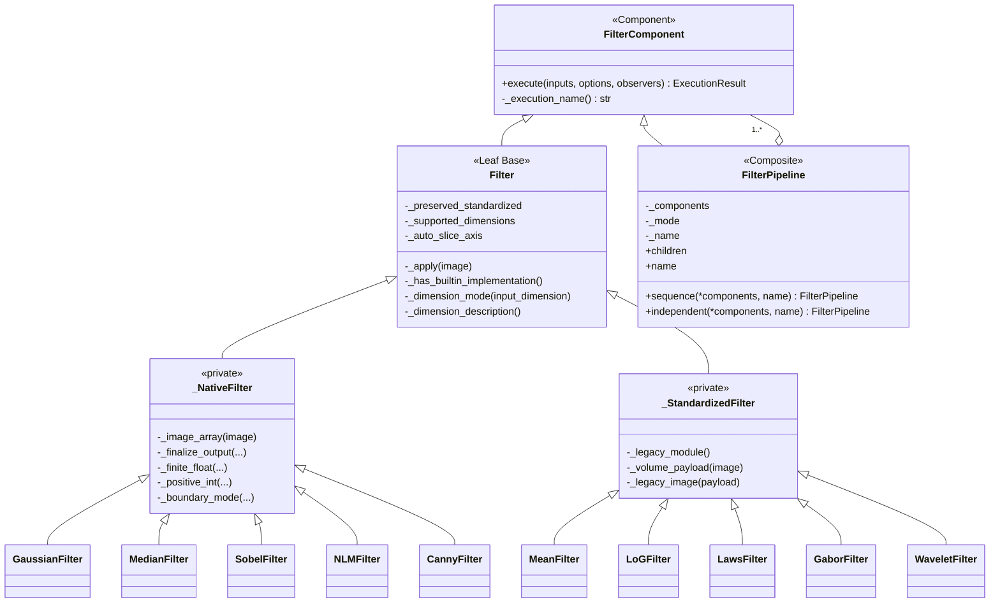
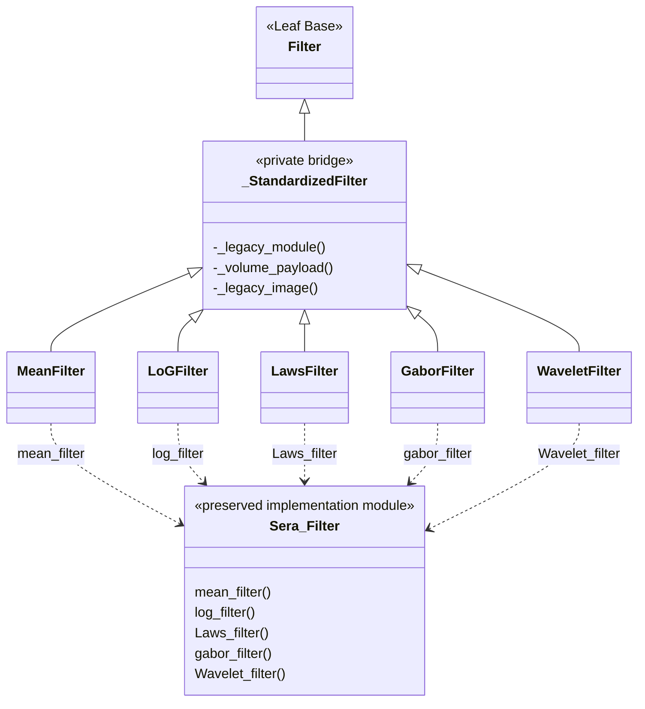
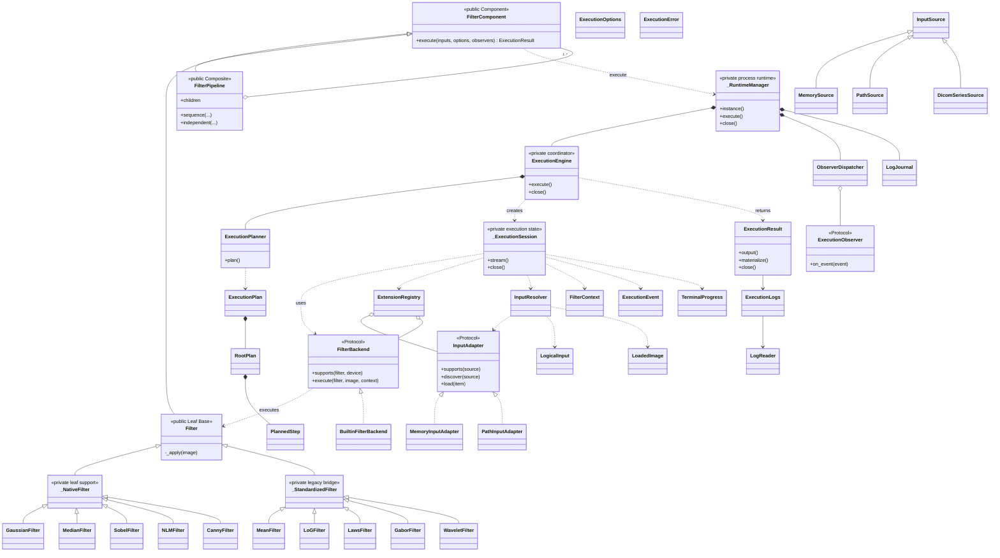

# Radiuma Filter — Architecture, Class Model, Filter Signatures, and API Usage

## 1. Purpose

This document defines the implemented architecture, class relationships, filter contracts, runtime responsibilities, extension boundaries, and client-facing API of Radiuma Filter.

The package is fully implemented and ready for use. The document describes the source as implemented; it does not define placeholder classes, future stubs, or an alternate execution facade.

The public filtering model is centered on one executable component hierarchy:

```text
FilterComponent
│
├── Filter
│   ├── GaussianFilter
│   ├── MedianFilter
│   ├── SobelFilter
│   ├── NLMFilter
│   ├── CannyFilter
│   ├── MeanFilter
│   ├── LoGFilter
│   ├── LawsFilter
│   ├── GaborFilter
│   └── WaveletFilter
│
└── FilterPipeline
```

Every public filtering component exposes the same execution operation:

```python
component.execute(
    inputs=...,
    options=...,
    observers=...,
)
```

There is no separate public execution client or cardinality-specific execution facade.

---

# 2. Architectural Rules

The implementation follows these rules:

```text
FilterComponent
    = common executable Composite component

Filter
    = numerical leaf definition

FilterPipeline
    = composite of FilterComponent objects

Execution runtime
    = private orchestration infrastructure

InputAdapter
    = input-format extension contract

FilterBackend
    = filter-execution Strategy contract

ExecutionObserver
    = semantic execution-event Observer contract
```

The runtime remains filter-method agnostic. It plans and executes `FilterComponent` objects without embedding branches for individual filter classes.

Concrete numerical behavior belongs to the relevant filter class or its private shared filter base.

The following responsibilities do not belong to individual concrete filters:

```text
input discovery
folder traversal
file loading
backend selection
concurrency
progress reporting
observer dispatch
structured diagnostics
result streaming
execution identity
```

---

# 3. Source-Only Project Tree

The cleaned project source contains only the implementation package:

```text
src/
└── radiuma_filter/
    ├── __init__.py
    ├── api/
    │   ├── __init__.py
    │   ├── errors.py
    │   ├── execution.py
    │   ├── extensions.py
    │   ├── identity.py
    │   └── logs.py
    ├── filters/
    │   ├── __init__.py
    │   ├── core/
    │   │   ├── __init__.py
    │   │   └── component.py
    │   ├── native/
    │   │   ├── __init__.py
    │   │   ├── base.py
    │   │   ├── gaussian.py
    │   │   ├── median.py
    │   │   ├── sobel.py
    │   │   ├── nlm.py
    │   │   └── canny.py
    │   └── standardized/
    │       ├── __init__.py
    │       ├── base.py
    │       ├── mean.py
    │       ├── log.py
    │       ├── laws.py
    │       ├── gabor.py
    │       ├── wavelet.py
    │       └── legacy/
    │           ├── __init__.py
    │           ├── sera_filter.py
    │           └── sera_readwrite.py
    └── runtime/
        ├── __init__.py
        ├── execution/
        │   ├── __init__.py
        │   └── engine.py
        ├── extensions/
        │   ├── __init__.py
        │   └── registry.py
        ├── io/
        │   ├── __init__.py
        │   └── inputs.py
        └── observability/
            ├── __init__.py
            ├── dispatcher.py
            ├── journal.py
            └── storage.py
```

The `src/` package contains implementation code only. Project-level packaging metadata, examples, and this architecture document remain outside the import package, while IDE metadata, caches, compiled bytecode, and build output are excluded.

---

# 4. Public Composite Model

## Exact Address

```text
src/radiuma_filter/filters/core/component.py
```

## 4.1 `FilterComponent`

`FilterComponent` is the common Component abstraction of the Composite design.

Implemented public signature:

```python
class FilterComponent:
    def execute(
        self,
        *,
        inputs: object | Iterable[object],
        options: ExecutionOptions | None = None,
        observers: ExecutionObserver
        | Iterable[ExecutionObserver]
        | None = None,
    ) -> ExecutionResult:
        ...
```

Responsibilities:

```text
common executable abstraction
public execute(...) entry point
runtime delegation
stable runtime-facing execution name
```

`FilterComponent.execute()` delegates to the private runtime manager. It does not perform numerical filtering itself.

---

## 4.2 `Filter`

`Filter` is the Leaf abstraction.

Implemented protected contract:

```python
class Filter(FilterComponent):
    _preserved_standardized: ClassVar[bool] = False
    _supported_dimensions: ClassVar[tuple[int, ...] | None] = None
    _auto_slice_axis: ClassVar[int | None] = None

    def _apply(self, image: Any) -> Any:
        ...

    @classmethod
    def _has_builtin_implementation(cls) -> bool:
        ...

    @classmethod
    def _dimension_mode(cls, input_dimension: int) -> str:
        ...

    @classmethod
    def _dimension_description(cls) -> str:
        ...
```

Responsibilities:

```text
leaf-filter identity
filter capability metadata
built-in numerical hook
2D/3D compatibility declaration
optional automatic 3D-to-2D slicing capability
```

---

## 4.3 `FilterPipeline`

`FilterPipeline` is the Composite implementation.

Implemented construction forms:

```python
FilterPipeline(
    *components: FilterComponent,
    name: str | None = None,
)
```

```python
FilterPipeline.sequence(
    *components: FilterComponent,
    name: str | None = None,
)
```

```python
FilterPipeline.independent(
    *components: FilterComponent,
    name: str | None = None,
)
```

`FilterPipeline(...)` and `FilterPipeline.sequence(...)` both represent sequential composition.

Sequential semantics:

```text
input
  ↓
component 1
  ↓
component 2
  ↓
component 3
  ↓
output
```

Independent semantics:

```text
             ┌── component 1 ──> output
input ───────┼── component 2 ──> output
             └── component 3 ──> output
```

An independent pipeline may contain a sequential pipeline as one independent root. An independent pipeline cannot be inserted as a single step inside a sequential pipeline because one sequential step must produce one stream for the next step.

---

# 5. Canonical Filter Class Diagram



---

# 6. Filter Definition and Implementation Ownership

The filter source is divided into three cohesive files:

```text
filters/core.py
    architectural abstractions

filters/native.py
    native filter definitions + native numerical implementations

filters/standardized.py
    standardized public definitions + bridge to preserved implementation
```

The private `_NativeFilter` base centralizes behavior shared only by native filter leaves.

The private `_StandardizedFilter` base centralizes behavior shared only by the standardized filter bridge.

No public user code needs either private base class.

---

# 7. Native Filters

## Exact Address

```text
src/radiuma_filter/filters/native/
```

The native filter classes own their parameters, validation, dimensional capability, and numerical implementation.

All native filters use the built-in backend when an applicable external backend is not selected.

---

## 7.1 `GaussianFilter`

Signature:

```python
GaussianFilter(
    sigma: float = 1.0,
    truncate: float = 4.0,
    boundary_mode: Literal["reflect", "nearest", "constant"] = "reflect",
    constant_value: float = 0.0,
    preserve_scalar_type: bool = True,
)
```

Supported dimensions:

```text
2D
3D
```

Implementation ownership:

```text
GaussianFilter._apply()
GaussianFilter._kernel()
GaussianFilter._convolve_axis()
```

Validation includes finite sigma/truncation/constant values and a supported boundary mode.

---

## 7.2 `MedianFilter`

Signature:

```python
MedianFilter(
    radius: int,
    boundary_mode: Literal["reflect", "nearest", "constant"] = "reflect",
    constant_value: float = 0.0,
    preserve_scalar_type: bool = True,
)
```

Supported dimensions:

```text
2D
3D
```

The implementation is owned by `MedianFilter._apply()` and uses the configured isotropic radius.

---

## 7.3 `SobelFilter`

Signature:

```python
SobelFilter(
    axis: int | None = None,
    boundary_mode: Literal["reflect", "nearest", "constant"] = "reflect",
    constant_value: float = 0.0,
    preserve_scalar_type: bool = False,
)
```

Supported dimensions:

```text
2D
3D
```

When `axis=None`, the implementation calculates gradient magnitude from per-axis Sobel components. When an axis is supplied, the derivative is calculated for that axis.

---

## 7.4 `NLMFilter`

Signature:

```python
NLMFilter(
    patch_size: int = 7,
    patch_distance: int = 11,
    h: float = 0.1,
    sigma: float = 0.0,
    fast_mode: bool = True,
    preserve_scalar_type: bool = False,
)
```

Supported dimensions:

```text
2D
3D
```

Important implemented constraints include:

```text
patch_size >= 1
patch_size is odd
patch_distance >= 1
h > 0
sigma >= 0
```

---

## 7.5 `CannyFilter`

Signature:

```python
CannyFilter(
    sigma: float = 1.0,
    low_threshold: float | None = None,
    high_threshold: float | None = None,
    use_quantiles: bool = False,
    boundary_mode: Literal["reflect", "nearest", "constant"] = "reflect",
    constant_value: float = 0.0,
)
```

Directly supported dimension:

```text
2D
```

Automatic runtime adaptation:

```text
3D input
    ↓
automatic 2D slicing on the declared axis
    ↓
CannyFilter._apply() for each slice
    ↓
3D reconstruction
```

The client does not perform this slicing manually.

When `use_quantiles=True`, supplied thresholds are validated within `[0, 1]`.

---

# 8. Standardized Filters

## Exact Address

```text
src/radiuma_filter/filters/standardized/
```

The standardized filters are public filter definitions and bridges to the preserved implementation in:

```text
src/radiuma_filter/filters/standardized/legacy/sera_filter.py
src/radiuma_filter/filters/standardized/legacy/sera_readwrite.py
```

All standardized filters declare 3D support at the Filtering runtime boundary.

The standardized bridge preserves each filter's own `by_slice` semantics. Runtime dimensional adaptation does not reinterpret those algorithm-specific parameters.

The built-in standardized implementation is pinned and cannot be silently replaced by an external backend.

---

## 8.1 `MeanFilter`

Signature:

```python
MeanFilter(
    *,
    by_slice: bool,
    BoundaryCondition: str,
    FilterSize: int,
)
```

Delegates numerical execution to:

```text
Sera_Filter.mean_filter
```

---

## 8.2 `LoGFilter`

Signature:

```python
LoGFilter(
    *,
    by_slice: bool,
    BoundaryCondition: str,
    img_average: bool,
    riesz_steered: bool,
    sigma: float,
    sigma_cutoff: float,
    riesz: tuple[int, ...] | list[int] | None,
)
```

Delegates numerical execution to:

```text
Sera_Filter.log_filter
```

---

## 8.3 `LawsFilter`

Signature:

```python
LawsFilter(
    *,
    by_slice: bool,
    BoundaryCondition: str,
    Kernel: str,
    pooling_method: str,
    cal_energy: bool,
    rotation_inver: bool,
    delta: int,
)
```

Delegates numerical execution to:

```text
Sera_Filter.Laws_filter
```

---

## 8.4 `GaborFilter`

Signature:

```python
GaborFilter(
    *,
    by_slice: bool,
    BoundaryCondition: str,
    pooling_method: str,
    response: str,
    rotation_inver: bool,
    gamma: float,
    lambdaa: float,
    sigma: float,
    step: float,
    theta_initial: float,
    SigmaTruncate: float | None,
)
```

Delegates numerical execution to:

```text
Sera_Filter.gabor_filter
```

---

## 8.5 `WaveletFilter`

Signature:

```python
WaveletFilter(
    *,
    by_slice: bool,
    mode: str,
    filter_config: str,
    pooling_method: str,
    wavelet_family: str,
    riesz_steered: bool,
    rot_invariance: bool,
    decomposition_level: int,
    filter_size: int | tuple[int, ...] | list[int],
    riesz: tuple[int, ...] | list[int] | None,
    wavelet_type: str,
)
```

Delegates numerical execution to:

```text
Sera_Filter.Wavelet_filter
```

---

# 9. Standardized Implementation Relationship



---

# 10. Execution API

## Exact Address

```text
src/radiuma_filter/api/execution.py
```

## 10.1 `ExecutionOptions`

Signature:

```python
ExecutionOptions(
    max_in_flight: int = 1,
    error_policy: ErrorPolicy = ErrorPolicy.RAISE,
    device: DevicePreference = DevicePreference.AUTO,
    progress: bool = True,
)
```

Implemented policies:

```text
ErrorPolicy.RAISE
ErrorPolicy.COLLECT

DevicePreference.AUTO
DevicePreference.CPU
DevicePreference.GPU
```

`max_in_flight` must be at least `1`.

---

## 10.2 `ExecutionObserver`

Contract:

```python
@runtime_checkable
class ExecutionObserver(Protocol):
    def on_event(self, event: ExecutionEvent) -> None:
        ...
```

Event types:

```text
EXECUTION_STARTED
EXECUTION_COMPLETED
EXECUTION_FAILED
FILTER_STARTED
FILTER_COMPLETED
FILTER_FAILED
PROBLEM
```

Observer notifications are semantic runtime events and remain separate from structured diagnostics.

---

## 10.3 `ExecutionResult`

Public operations:

```python
result.id
result.roots
result.logs
result.errors
result.is_materialized
result.is_closed

result.output()
result.materialize()
result.close()
```

`output()` is a lazy single-pass stream unless `materialize()` is called first.

Each yielded output record supports identity-based lookup:

```python
value = output[filter_component]
```

This means two equal-valued but distinct filter instances remain distinct roots.

---

# 11. Execution Architecture

The main execution spine is:

```text
FilterComponent.execute()
        │
        ▼
_RuntimeManager
        │
        ▼
ExecutionEngine
        │
        ▼
_ExecutionSession
        │
        ▼
FilterBackend
        │
        ▼
Filter._apply()
```

The supporting services are collaborators, not additional sequential execution stages:

```text
ExecutionEngine
├── ExecutionPlanner
├── ExtensionRegistry
├── InputResolver
└── LogJournal

_ExecutionSession
├── TerminalProgress
├── observer/event emission
├── concurrency
├── error collection
├── dimensional adaptation
└── result streaming
```

This distinction keeps the execution architecture readable while preserving the actual implementation boundaries.

---

# 12. Execution Planning

## Exact Address

```text
src/radiuma_filter/runtime/execution/engine.py
```

Implemented planning classes:

```text
ExecutionPlanner
ExecutionPlan
RootPlan
PlannedStep
```

Planning converts one public `FilterComponent` into:

```text
independent execution roots
    +
ordered leaf-filter steps per root
```

Sequential pipeline:

```text
FilterPipeline.sequence(a, b, c)
            ↓
RootPlan
├── PlannedStep(a)
├── PlannedStep(b)
└── PlannedStep(c)
```

Independent pipeline:

```text
FilterPipeline.independent(a, b, c)
            ↓
RootPlan(a)
RootPlan(b)
RootPlan(c)
```

The same `FilterComponent` instance cannot appear twice as an independent root. Distinct equal-valued instances are valid.

Recursive pipeline cycles are rejected.

---

# 13. Input Model and Adapters

## Public Contracts

```text
src/radiuma_filter/api/extensions.py
```

## Built-in Runtime Adapters

```text
src/radiuma_filter/runtime/io/inputs.py
```

The public normalized source hierarchy is:

```text
InputSource
├── MemorySource
├── PathSource
└── DicomSeriesSource
```

The input adapter contract is:

```python
@runtime_checkable
class InputAdapter(Protocol):
    def supports(self, source: InputSource) -> bool:
        ...

    def discover(
        self,
        source: InputSource,
    ) -> Iterator[tuple[str, InputSource]]:
        ...

    def load(self, item: LogicalInput) -> Any:
        ...
```

Built-in adapters:

```text
MemoryInputAdapter
PathInputAdapter
```

The same public `inputs=` argument accepts:

```text
in-memory array-like image
single file path
directory path
ordered flat collection of inputs
adapter-specific InputSource
```

Mappings, unordered sets, and ambiguous nested collections are rejected.

Built-in path handling includes:

```text
NumPy .npy
common scalar raster files
NIfTI
NRRD
MHA/MHD
DICOM files
DICOM series
extensionless medical files when readable through SimpleITK
```

Folder discovery is deterministic.

---

# 14. Loaded Image Model

`LoadedImage` is the metadata-preserving internal image payload used between input loading and filter backends.

Implemented fields:

```python
LoadedImage(
    data,
    spacing=None,
    origin=None,
    direction=None,
    metadata={},
    source=None,
    native=None,
)
```

It preserves image data together with available spatial/source metadata.

`LoadedImage.with_data(...)` creates a new immutable payload while retaining compatible metadata.

---

# 15. Filter Backend Strategy

## Public Contract

```text
src/radiuma_filter/api/extensions.py
```

```python
@runtime_checkable
class FilterBackend(Protocol):
    def supports(
        self,
        filter: Filter,
        *,
        device: DevicePreference,
    ) -> bool:
        ...

    def execute(
        self,
        filter: Filter,
        *,
        image: Any,
        context: FilterContext,
    ) -> Any:
        ...
```

## Built-in Strategy

```text
src/radiuma_filter/runtime/extensions/registry.py
```

`BuiltinFilterBackend` executes leaf filters carrying a built-in `_apply()` implementation on `AUTO` or `CPU`.

The runtime extension groups are:

```text
radiuma_filter.input_adapters
radiuma_filter.filter_backends
```

External backends are resolved before the built-in fallback for non-standardized filters.

Standardized filters are deliberately pinned to their preserved implementation and are not silently replaced by an external backend.

---

# 16. Observer, Progress, and Logging

## Observer Dispatcher and Progress

```text
src/radiuma_filter/runtime/observability/dispatcher.py
```

Main classes:

```text
ObserverDispatcher
TerminalProgress
```

`ObserverDispatcher` asynchronously distributes immutable `ExecutionEvent` instances.

`TerminalProgress` represents overall execution progress. It tracks filter-run completion, input completion, current filter activity, elapsed duration, and estimated remaining duration.

## Structured Diagnostics

```text
src/radiuma_filter/runtime/observability/journal.py
src/radiuma_filter/runtime/observability/storage.py
```

Main classes:

```text
LogJournal
ExecutionLogSource
_DiagnosticSanitizer
_DurableSpool
_LogWriter
```

Public log-view classes are in:

```text
src/radiuma_filter/api/logs.py
```

including:

```text
ExecutionLogs
LogReader
LogRecord
LogLevel
LogChannel
```

Observer events and diagnostic logs remain separate concerns.

---

# 17. Error Model

## Exact Address

```text
src/radiuma_filter/api/errors.py
```

Implemented hierarchy:

```text
FilteringError
├── InvalidExecutionError
│   └── DuplicateComponentError
├── InvalidPipelineError
├── ResultStateError
├── UnsupportedInputError
├── UnsupportedFilterError
└── BackendUnavailableError
```

`ErrorPolicy.RAISE` stops execution according to the raised failure path.

`ErrorPolicy.COLLECT` records execution errors while preserving available successful outputs.

---

# 18. Public Export Surface

The normal public surface is exported through:

```python
from radiuma_filter import (
    BackendUnavailableError,
    CannyFilter,
    DevicePreference,
    DuplicateComponentError,
    ErrorPolicy,
    EventType,
    ExecutionEvent,
    ExecutionObserver,
    ExecutionOptions,
    ExecutionResult,
    Filter,
    FilterComponent,
    FilterPipeline,
    FilteringError,
    GaborFilter,
    GaussianFilter,
    InvalidExecutionError,
    InvalidPipelineError,
    LawsFilter,
    LoGFilter,
    MeanFilter,
    MedianFilter,
    NLMFilter,
    ResultStateError,
    SobelFilter,
    UnsupportedFilterError,
    UnsupportedInputError,
    WaveletFilter,
)
```

Advanced stable submodule imports are also exposed for:

```text
radiuma_filter.errors
radiuma_filter.execution
radiuma_filter.extensions
radiuma_filter.identity
radiuma_filter.logs
```

---

# 19. Overall Class Diagram

The following view combines the major implemented parts while preserving subsystem boundaries.



This diagram intentionally treats storage internals such as spool frames and writer frames as implementation details beneath `LogJournal`; they are not part of the filtering domain model.

---

# 20. Responsibility Map

```text
Public component model
    src/radiuma_filter/filters/core/component.py

Native filter definitions + algorithms
    src/radiuma_filter/filters/native/

Standardized filter definitions + preserved bridge
    src/radiuma_filter/filters/standardized/

Preserved standardized algorithms
    src/radiuma_filter/filters/standardized/legacy/sera_filter.py
    src/radiuma_filter/filters/standardized/legacy/sera_readwrite.py

Execution policies/results/events
    src/radiuma_filter/api/execution.py

Extension contracts + shared image/source models
    src/radiuma_filter/api/extensions.py

Structured log API
    src/radiuma_filter/api/logs.py

Execution planning + orchestration
    src/radiuma_filter/runtime/execution/engine.py

Extension discovery + backend resolution
    src/radiuma_filter/runtime/extensions/registry.py

Input discovery + loading
    src/radiuma_filter/runtime/io/inputs.py

Observer dispatch + terminal progress
    src/radiuma_filter/runtime/observability/dispatcher.py

Diagnostic journal
    src/radiuma_filter/runtime/observability/journal.py

Durable diagnostic storage
    src/radiuma_filter/runtime/observability/storage.py
```

---

# 21. Client API Usage

The consuming application does not create a separate execution client. It creates a filter or pipeline and executes that component directly.

## 21.1 Shared Setup

```python
from pathlib import Path

from radiuma_filter import (
    CannyFilter,
    ErrorPolicy,
    ExecutionOptions,
    FilterPipeline,
    GaussianFilter,
    MedianFilter,
)

single_image = Path("image.nii.gz")
image_folder = Path("images")

gaussian = GaussianFilter(sigma=1.5)
median = MedianFilter(radius=2)
canny = CannyFilter(
    low_threshold=0.10,
    high_threshold=0.20,
    use_quantiles=True,
)

sequence = FilterPipeline.sequence(
    gaussian,
    median,
    canny,
    name="denoise-and-edge",
)

independent = FilterPipeline.independent(
    gaussian,
    median,
    canny,
    name="independent-filters",
)
```

---

## 21.2 Case 1 — One Filter × One Image

```python
result = gaussian.execute(
    inputs=single_image,
)

for output in result.output():
    filtered = output[gaussian]
```

---

## 21.3 Case 2 — One Filter × Multiple Images

```python
result = gaussian.execute(
    inputs=image_folder,
    options=ExecutionOptions(
        max_in_flight=4,
        error_policy=ErrorPolicy.COLLECT,
    ),
)

for output in result.output():
    if output.errors:
        continue

    filtered = output[gaussian]
```

---

## 21.4 Case 3 — Multiple Independent Filters × One Image

```python
result = independent.execute(
    inputs=single_image,
)

for output in result.output():
    gaussian_image = output[gaussian]
    median_image = output[median]
    canny_image = output[canny]
```

---

## 21.5 Case 4 — Multiple Independent Filters × Multiple Images

```python
result = independent.execute(
    inputs=image_folder,
    options=ExecutionOptions(
        max_in_flight=4,
        error_policy=ErrorPolicy.COLLECT,
    ),
)

for output in result.output():
    if output.errors:
        # Successful independent roots remain available when errors are collected.
        pass
```

---

## 21.6 Case 5 — Sequential Pipeline × One Image

```python
result = sequence.execute(
    inputs=single_image,
)

for output in result.output():
    filtered = output[sequence]
```

---

## 21.7 Case 6 — Sequential Pipeline × Multiple Images

```python
result = sequence.execute(
    inputs=image_folder,
    options=ExecutionOptions(
        max_in_flight=4,
        error_policy=ErrorPolicy.COLLECT,
    ),
)

for output in result.output():
    if output.errors:
        continue

    filtered = output[sequence]
```

---

# 22. Extension Example Shape

A third-party input adapter implements the public `InputAdapter` protocol and is published under:

```text
radiuma_filter.input_adapters
```

A third-party filter backend implements the public `FilterBackend` protocol and is published under:

```text
radiuma_filter.filter_backends
```

The generic runtime discovers these extensions without adding filter-specific branches to the execution engine.

---

# 23. Design Invariants

> Every normal filtering operation starts from a `FilterComponent` and uses the same `execute(inputs=...)` operation.

> `Filter` is a numerical leaf; `FilterPipeline` is a Composite and is not a numerical filter.

> `FilterPipeline.sequence(...)` expresses ordered data flow.

> `FilterPipeline.independent(...)` expresses independent roots over the same input set.

> Native numerical behavior is owned by the corresponding native filter class or the private `_NativeFilter` support base.

> Standardized filter definitions own the bridge to the preserved standardized implementation without rewriting that implementation.

> The runtime remains generic and does not branch on specific built-in filter class names.

> Input format handling remains behind `InputAdapter` and `InputResolver`.

> Backend execution remains behind `FilterBackend`.

> Standardized filters remain pinned to the preserved implementation.

> Observer events and structured diagnostics remain separate subsystems.

> Result lookup is identity-based.

> The same filter or pipeline API is used for one image, a folder, an ordered input collection, or in-memory image data.

> 2D/3D adaptation is a runtime capability decision rather than a responsibility of client code.

---

# 24. Final Architectural View

```text
Client application
      │
      ▼
FilterComponent
├── Filter
│   └── concrete numerical leaf
│
└── FilterPipeline
    ├── sequence(...)
    └── independent(...)
      │
      ▼ execute(inputs=...)
_RuntimeManager
      │
      ▼
ExecutionEngine
├── ExecutionPlanner
├── ExtensionRegistry
├── InputResolver
└── LogJournal
      │
      ▼
_ExecutionSession
├── ObserverDispatcher / ExecutionEvent
├── TerminalProgress
├── ErrorPolicy handling
├── dimensional adaptation
├── bounded concurrency
└── lazy result streaming
      │
      ▼
FilterBackend
      │
      ▼
Filter._apply()
      │
      ▼
ExecutionResult
├── output()
├── materialize()
├── errors
└── logs
```

The architecture therefore keeps the client-facing model compact while retaining separate, replaceable infrastructure for input handling, backend execution, observability, diagnostics, and result streaming.
